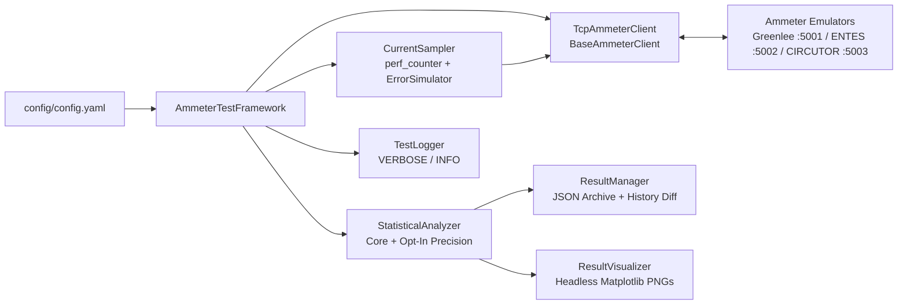

# Ammeter Testing Framework — Embedded Systems QA Automation

A modular, configuration-driven Python testing framework for evaluating embedded current measurement ammeter emulators (**Greenlee**, **ENTES**, and **CIRCUTOR**).

Full system requirements and architecture specification: [docs/SDR.md](docs/SDR.md).

---

## Architecture Overview



### Key Design Decisions
1. **Strict SUT Immutability**: Vendor emulator implementations (`Ammeters/Greenlee_Ammeter.py`, `Ammeters/Entes_Ammeter.py`, `Ammeters/Circutor_Ammeter.py`) were **never modified**. Only minimal infrastructure fixes were applied to `base_ammeter.py`, `client.py`, and `main.py` (documented below).
2. **KISS + Scalable OOP Client (`src/testing/ammeter_client.py`)**: All TCP emulators share the same wire contract (`command -> float`). `BaseAmmeterClient` (ABC) defines the interface, and a single config-driven `TcpAmmeterClient` serves all TCP ammeters — adding a 4th/5th TCP ammeter requires **zero Python code changes** (only a YAML entry). Non-TCP protocols can subclass `BaseAmmeterClient` cleanly.
3. **2-of-3 Sampling Resolver (`src/utils/config.py`)**: Because `count = duration × frequency` is over-constrained, any 2 of (`measurements_count`, `total_duration_seconds`, `sampling_frequency_hz`) automatically derive the 3rd, and providing all 3 validates consistency (`ValueError` on conflict).
4. **Shared Analytics + Opt-In Precision Metrics (`src/analysis/analyzer.py`)**: Core metrics (`mean`, `median`, `std_dev`, `min`, `max`) run by default with zero per-ammeter duplication. Calibration/precision metrics (`CV`, `IQR`, `CI95`, `consistency_rating`) are **opt-in** via `include_precision_metrics=True` (or `--precision`) and used for cross-ammeter reliability ranking.
5. **SUT vs. Framework Log Separation (`src/utils/logger.py`)**: Emulator `stdout` prints are never mixed into test logs. A custom `VERBOSE` level (`15`) logs every individual sample reading (`elapsed`, `current_amps`); controlled via `result_management.log_level` in `config/config.yaml` (`VERBOSE` in dev/QA, switchable to `INFO` in production).
6. **Modular `pytest` Suites + Self-Contained HTML1 Report**: Per-ammeter test modules (`test_greenlee.py`, `test_entes.py`, `test_circutor.py`) with lazy fixtures start only the requested emulator(s). Every run generates `results/report.html` via `pytest-reporter-html1` with no external server dependencies.

---

## Setup & Installed Dependencies

Python **3.9+** compatible (tested on Python 3.9.6 macOS and Python 3.11 Ubuntu CI).

```bash
python3 -m venv .venv
source .venv/bin/activate        # Windows: .venv\Scripts\activate
pip install -r requirements.txt
```

### Installed Libraries (`requirements.txt`)
| Package | Purpose |
| :--- | :--- |
| `pyyaml>=6.0` | YAML configuration loading (`config/config.yaml`) |
| `numpy>=1.21.0` | Core statistical calculations |
| `scipy>=1.7.0` | Exact t-distribution 95% confidence intervals (`CI95`) |
| `matplotlib>=3.4.0` | Headless (`Agg`) PNG visualization reports |
| `seaborn>=0.11.0` | Starter dependency preserved for statistical plotting |
| `pandas>=1.3.0` | Starter dependency preserved for tabular analysis |
| `pytest>=7.0.0` | Modular test runner with marker-based selection |
| `pytest-reporter-html1>=0.9.0` | Single-file HTML test report (`results/report.html`) |

---

## Usage

### 1. Verify Fixed Starter Script (`main.py`)
Starts all three emulators on ports `5001–5003` and reads one current value from each:
```bash
python main.py
```

### 2. Run Full Framework CLI (`run_suite.py`)
```bash
# Run all configured ammeters using config/config.yaml defaults (30 samples, 3.0s -> 10 Hz)
python run_suite.py

# Custom sampling override + opt-in precision metrics (CV, IQR, CI95)
python run_suite.py --count 15 --duration 1.0 --precision --log-level INFO

# Test specific ammeter(s) only
python run_suite.py --ammeters greenlee entes --count 10 --frequency 10

# List archived historical runs and compare two runs
python run_suite.py --list-runs
python run_suite.py --compare-runs <RUN_ID_A> <RUN_ID_B>
```

### 3. Run Modular `pytest` Suite & HTML Report
Every `pytest` invocation generates a self-contained HTML report at `results/report.html`.

```bash
# Run full suite (21 tests: sanity, functional, unit, negative/error simulation)
pytest -v

# Pre-flight fail-fast sanity gate across all ammeters
pytest -m sanity -x -v

# Run a single ammeter suite (starts ONLY that emulator)
pytest -m greenlee -v
pytest -m entes -v
pytest -m circutor -v

# Combine markers freely
pytest -m "sanity and greenlee" -v
pytest -m "greenlee or entes" -v
pytest -m unit -v
pytest -m negative -v
```

---

## Starter Code Bug-Fix Log

Per specification: *"if you get an error in the code, please fix it and explain the fix in the documentation."*

| File | Bug Found | Fix Applied |
| :--- | :--- | :--- |
| `main.py` | Client calls were commented out and used truncated commands (`MEASURE_GREENLEE`, `MEASURE_ENTES`, `MEASURE_CIRCUTOR`). | Uncommented calls with exact protocol commands and added graceful emulator shutdown (`stop()`). |
| `README.md` / `config/config.yaml` vs `Circutor_Ammeter.py` | Docs listed `MEASURE_CIRCUTOR -get_measurement`, while `CircutorAmmeter` requires `MEASURE_CIRCUTOR -get_measurement -current`. | Updated `config/config.yaml` and docs to match the untouched emulator command. |
| Ports (`5000–5002` vs `5001–5003`) | `README.md` listed `5000–5002`, which conflicts with macOS `ControlCenter` (AirPlay Receiver) on port `5000`. | Standardized default ports to `5001` (Greenlee), `5002` (ENTES), `5003` (CIRCUTOR) in `config/config.yaml` and `main.py`. |
| `Ammeters/base_ammeter.py` | Missing `SO_REUSEADDR` caused `Address already in use` on restart; blocking `accept()` prevented clean thread shutdown. | Added `SO_REUSEADDR`, non-blocking accept timeout (`0.2s`), and `stop()` method. |
| `Ammeters/client.py` | `request_current_from_ammeter()` only printed output and returned `None`, with no socket timeout or error handling. | Parsed and returned `float`, added `timeout`, and raised descriptive `TimeoutError`/`ConnectionError`/`ValueError`. |
| `src/utils/logger.py` | Built `log_file` path without attaching handlers, formatter, or log level. | Attached `FileHandler` + `StreamHandler`, formatter, duplicate-handler guard, and `VERBOSE=15` level. |
| `src/testing/test_framework.py` | Missing `Dict` import (`NameError`) and empty `run_test()` (`pass`). | Implemented full `AmmeterTestFramework`. |

---

## Sample Test Results & Accuracy Findings

Sample artifacts included in the repository:
- **Archived JSON Runs**: `results/runs/run_20261122_123339_451a041f.json`, `results/runs/run_20261122_123344_2ad03c38.json`
- **Visual Reports**: `results/plots/*_time_series.png`, `results/plots/*_distribution.png`, `results/plots/*_summary_comparison.png`
- **HTML Test Report**: `results/report.html` (`21 passed`, 0 warnings)

### Cross-Ammeter Precision Observation
Because each emulator operates on a different physical scale (`0.001–0.1A` CIRCUTOR, `0.01–100A` Greenlee, `5–200A` ENTES), scale-independent **Coefficient of Variation (`CV = std_dev / mean`)** is used to assess relative precision:
- **#1 CIRCUTOR** (Rogowski 10-sample integration): consistently achieves the lowest `CV` (~`48%–56%`) because summing 10 voltage samples averages out random variance.
- **#2 ENTES** (Hall Effect `B × K`): moderate-to-high dispersion (~`61%` CV).
- **#3 Greenlee** (Ohm's Law `V / R`): highest relative dispersion (~`80%+` CV) due to heavy right-skew spikes when `R → 0.1Ω`.

---

## CI/CD (GitHub Actions)

Workflow: `.github/workflows/ci.yml`
1. Runs `pytest -m sanity -x -v` as a fail-fast pre-flight gate.
2. Runs full `pytest -v` (or a selected marker via manual `workflow_dispatch`).
3. Executes `python run_suite.py --count 15 --duration 1.0 --precision --log-level INFO`.
4. Uploads `results/report.html`, `results/runs/`, and `results/plots/` as downloadable workflow artifacts.
