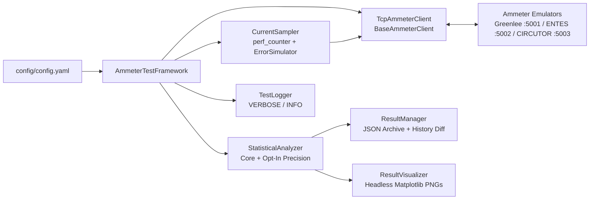

# Ammeter Testing Framework — Embedded Systems QA Automation

A modular, configuration-driven Python testing framework for evaluating embedded current measurement ammeter emulators (**Greenlee**, **ENTES**, and **CIRCUTOR**).

Full system requirements and architecture specification: [docs/SDR.md](docs/SDR.md).

---

## Architecture Overview



### Key Design Decisions
1. **Strict SUT Immutability**: Vendor emulator implementations (`Ammeters/Greenlee_Ammeter.py`, `Ammeters/Entes_Ammeter.py`, `Ammeters/Circutor_Ammeter.py`) were **never modified**. Only minimal infrastructure fixes were applied to `base_ammeter.py`, `client.py`, and `main.py` (documented below).
2. **KISS + Scalable OOP Client (`src/testing/ammeter_client.py`)**: All TCP emulators share the same wire contract (`command -> float`). `BaseAmmeterClient` (ABC) defines the interface, and a single config-driven `TcpAmmeterClient` serves all TCP ammeters — adding a 4th/5th TCP ammeter requires **zero Python code changes** (only a YAML entry). Non-TCP protocols can subclass `BaseAmmeterClient` cleanly.
3. **2-of-3 Sampling Resolver (`src/utils/config.py`)**: Because `count = duration × frequency` is over-constrained, any 2 of (`measurements_count`, `total_duration_seconds`, `sampling_frequency_hz`) automatically derive the 3rd, and providing all 3 validates consistency (`ValueError` on conflict).
4. **Shared Analytics + Opt-In Precision Metrics (`src/analysis/analyzer.py`)**: Core metrics (`mean`, `median`, `std_dev`, `min`, `max`) run by default with zero per-ammeter duplication. Calibration/precision metrics (`CV`, `IQR`, `CI95`, `consistency_rating`) are **opt-in** via `include_precision_metrics=True` (or `--precision`) and used for cross-ammeter reliability ranking.
5. **SUT vs. Framework Log Separation (`src/utils/logger.py`)**: Emulator `stdout` prints are never mixed into test logs. A custom `VERBOSE` level (`15`) logs every individual sample reading (`elapsed`, `current_amps`); controlled via `result_management.log_level` in `config/config.yaml` (`VERBOSE` in dev/QA, switchable to `INFO` in production).
6. **Modular `pytest` Suites + Per-Run HTML1 Reports with Embedded Plots & Retention**: Per-ammeter test modules (`test_greenlee.py`, `test_entes.py`, `test_circutor.py`) with lazy fixtures start only the requested emulator(s). Every run generates a unique `results/reports/report_<run_id>.html` with real PNG plots embedded inline (falling back to clearly labeled `[VIRTUAL / MOCK DATA]` only if no real run exists) and enforces configurable `max_reports` retention (default `10`).

---

## Setup & Installed Dependencies

Python **3.9+** compatible (tested on Python 3.9.6 macOS and Python 3.11 Ubuntu CI).

```bash
python3 -m venv .venv
source .venv/bin/activate        # Windows: .venv\Scripts\activate
pip install -r requirements.txt
```

### Installed Libraries (`requirements.txt`)
| Package | Purpose |
| :--- | :--- |
| `pyyaml>=6.0` | YAML configuration loading (`config/config.yaml`) |
| `numpy>=1.21.0` | Core statistical calculations |
| `scipy>=1.7.0` | Exact t-distribution 95% confidence intervals (`CI95`) |
| `matplotlib>=3.4.0` | Headless (`Agg`) PNG visualization reports |
| `seaborn>=0.11.0` | Starter dependency preserved for statistical plotting |
| `pandas>=1.3.0` | Starter dependency preserved for tabular analysis |
| `pytest>=7.0.0` | Modular test runner with marker-based selection |
| `pytest-reporter-html1>=0.9.0` | Single-file HTML test report (`results/report.html`) |

---

## Usage

### 1. Verify Fixed Starter Script (`main.py`)
Starts all three emulators on ports `5001–5003` and reads one current value from each:
```bash
python main.py
```

### 2. Run Full Framework CLI (`run_suite.py`)
```bash
# Run all configured ammeters using config/config.yaml defaults (30 samples, 3.0s -> 10 Hz)
python run_suite.py

# Custom sampling override + opt-in precision metrics (CV, IQR, CI95)
python run_suite.py --count 15 --duration 1.0 --precision --log-level INFO

# Test specific ammeter(s) only
python run_suite.py --ammeters greenlee entes --count 10 --frequency 10

# List archived historical runs and compare two runs
python run_suite.py --list-runs
python run_suite.py --compare-runs <RUN_ID_A> <RUN_ID_B>
```

### 3. Run Modular `pytest` Suite & HTML Report
Every `pytest` invocation generates a unique, self-contained HTML1 report under `results/reports/report_<run_id>.html` with embedded real PNG plots and automatic `max_reports` retention (default `10`).

```bash
# Run full suite (22 tests: sanity, per-ammeter functional, unit, negative/error simulation)
pytest -v

# Pre-flight fail-fast sanity gate across all ammeters
pytest -m sanity -x -v

# Run a single ammeter suite (lazy fixtures start ONLY that emulator)
pytest -m greenlee -v
pytest -m entes -v
pytest -m circutor -v

# Combine markers freely
pytest -m "sanity and greenlee" -v
pytest -m "greenlee or entes" -v
pytest -m unit -v
pytest -m negative -v
```

---

## Test Suite Coverage Matrix (What We Test & Why)

Every test in `tests/` maps directly to a core requirement, bonus challenge, or evaluation criterion from `Exam/ammeter-test-specification.md`. All 22 tests complete in ~`4s`.

### Per-Ammeter Sanity & Functional Suites (`test_greenlee.py`, `test_entes.py`, `test_circutor.py`)
Each ammeter has its own isolated suite and pytest marker (`greenlee`, `entes`, `circutor`) so teams can run one device, a subset, or all devices independently:

| Test (per ammeter) | Markers | What It Verifies & Why | Assignment Requirement |
| :--- | :--- | :--- | :--- |
| `test_<ammeter>_sanity` | `<ammeter>`, `sanity` | Pre-flight TCP reachability and valid physical range (`Greenlee: 0.01–100A`, `ENTES: 5–200A`, `CIRCUTOR: 0.001–0.1A`). Used as a fail-fast gate (`-m sanity -x`) before running the full suite. | Core #1 (Unified API) |
| `test_<ammeter>_sampling_and_core_stats` | `<ammeter>` | Collects 8 timed samples, validates exact sample count, zero errors, core metrics (`mean`, `median`, `std_dev`, `min`, `max`), confirms precision metrics are off by default, and embeds the real time-series PNG plot into the HTML1 report. | Core #2 (Sampling) & #3 (Result Analysis) |
| `test_<ammeter>_opt_in_precision_metrics` | `<ammeter>` | Enables `include_precision_metrics=True`, validates `CV`, `IQR`, `CI95`, and `consistency_rating`, and embeds real time-series + boxplot PNGs and summary into the HTML1 report. | Bonus #5 (Accuracy & Precision) |

### Framework Unit Tests (`tests/test_framework_unit.py` — marker: `unit`)
Live emulator values are stochastic; offline deterministic unit tests guarantee exact math, config safety, archiving, and visualization:

| Test | What It Verifies & Why | Assignment Requirement |
| :--- | :--- | :--- |
| `test_sampling_resolver_all_two_of_three_pairs` | Any 2 of (`count`, `duration`, `frequency`) accurately derive the 3rd. | Core #2 (Sampling) |
| `test_sampling_resolver_rejects_conflicts_and_invalid_inputs` | Conflicting 3-of-3, under-specified (<2), or non-positive values raise `ValueError`. | Core #2 + Eval #3 (Error Handling) |
| `test_logger_verbose_vs_info_filtering` | `VERBOSE` (level 15) logs per-sample readings for QA auditing; `INFO` suppresses them for production clarity. | QA Engineering Enhancement |
| `test_statistical_analyzer_core_and_precision_metrics` | Deterministic math verification on `[10, 20, 30, 40, 50]` for exact core + opt-in precision metrics and empty-input error handling. | Core #3 + Bonus #5 |
| `test_cross_ammeter_accuracy_ranking` | Verifies scale-independent `CV` ranking identifies the more consistent ammeter (`steady` over `noisy`). | Bonus #5 (Reliability Ranking) |
| `test_result_manager_archive_retrieve_and_compare` | Verifies unique `run_id`, JSON persistence, reload by ID, historical listing, `compare_runs()` deltas, and `FileNotFoundError` on unknown IDs. | Core #4 (Result Management) |
| `test_standalone_cleanup_old_reports_and_artifacts` | Prunes linked HTML reports, PNG plots, and JSON runs older than `max_reports` (`@pytest.mark.cleanup`) so disk usage stays bounded. | QA Engineering Enhancement |
| `test_visualizer_generates_png_plots` | Always runs last in the session; generates combined `time_series`, `distribution` (with mean marker + legend), and `summary_comparison` PNGs from real session/archived data (falling back to clearly labeled `[VIRTUAL / MOCK DATA]` only if no real run exists) and embeds them in the HTML1 report. | Bonus #3 (Visualization) |

### Error Simulation & Negative Tests (`tests/test_error_simulation.py` — marker: `negative`)
Validates fault tolerance under simulated hardware anomalies and real TCP/protocol failures:

| Test | What It Verifies & Why | Assignment Requirement |
| :--- | :--- | :--- |
| `test_error_simulator_timeout_resilient_collection` | Simulated timeouts are captured cleanly in `errors` without crashing the sampling loop. | Bonus (Error Simulation) |
| `test_error_simulator_fail_fast_raises_immediately` | With `fail_fast=True`, simulated connection drops abort immediately as expected. | Bonus (Error Simulation) |
| `test_error_simulator_outlier_injection` | Simulated outlier multiplier injects controlled current spikes for anomaly testing. | Bonus (Error Simulation) |
| `test_connection_refused_on_closed_port` | Querying an unreachable TCP port raises a clear `ConnectionError`. | Eval #3 (Error Handling) |
| `test_invalid_command_against_live_greenlee_emulator` | Sending an invalid command to a live emulator (which closes with empty payload) raises `ValueError` cleanly. | Eval #3 (Error Handling) |

---

## Starter Code Bug-Fix Log

Per specification: *"if you get an error in the code, please fix it and explain the fix in the documentation."*

| File | Bug Found | Fix Applied |
| :--- | :--- | :--- |
| `main.py` | Client calls were commented out and used truncated commands (`MEASURE_GREENLEE`, `MEASURE_ENTES`, `MEASURE_CIRCUTOR`). | Uncommented calls with exact protocol commands and added graceful emulator shutdown (`stop()`). |
| `README.md` / `config/config.yaml` vs `Circutor_Ammeter.py` | Docs listed `MEASURE_CIRCUTOR -get_measurement`, while `CircutorAmmeter` requires `MEASURE_CIRCUTOR -get_measurement -current`. | Updated `config/config.yaml` and docs to match the untouched emulator command. |
| Ports (`5000–5002` vs `5001–5003`) | `README.md` listed `5000–5002`, which conflicts with macOS `ControlCenter` (AirPlay Receiver) on port `5000`. | Standardized default ports to `5001` (Greenlee), `5002` (ENTES), `5003` (CIRCUTOR) in `config/config.yaml` and `main.py`. |
| `Ammeters/base_ammeter.py` | Missing `SO_REUSEADDR` caused `Address already in use` on restart; blocking `accept()` prevented clean thread shutdown. | Added `SO_REUSEADDR`, non-blocking accept timeout (`0.2s`), and `stop()` method. |
| `Ammeters/client.py` | `request_current_from_ammeter()` only printed output and returned `None`, with no socket timeout or error handling. | Parsed and returned `float`, added `timeout`, and raised descriptive `TimeoutError`/`ConnectionError`/`ValueError`. |
| `src/utils/logger.py` | Built `log_file` path without attaching handlers, formatter, or log level. | Attached `FileHandler` + `StreamHandler`, formatter, duplicate-handler guard, and `VERBOSE=15` level. |
| `src/testing/test_framework.py` | Missing `Dict` import (`NameError`) and empty `run_test()` (`pass`). | Implemented full `AmmeterTestFramework`. |

---

## Generated Reports & Accuracy Findings

Generated runtime artifacts under `results/` are excluded from Git via `.gitignore` to keep the repository clean, and are produced automatically on every local run and uploaded as downloadable Artifacts in GitHub Actions:
- **HTML1 Test Reports**: `results/reports/report_<run_id>.html` (self-contained with embedded PNG plots, local-time `run_id`, and `max_reports: 10` retention)
- **Archived JSON Runs**: `results/runs/<run_id>.json` (metadata, raw timestamped samples, statistics, and cross-ammeter comparison)
- **Visual Reports**: `results/plots/*_time_series.png`, `results/plots/*_distribution.png`, `results/plots/*_summary_comparison.png`

### Cross-Ammeter Precision Observation
Because each emulator operates on a different physical scale (`0.001–0.1A` CIRCUTOR, `0.01–100A` Greenlee, `5–200A` ENTES), scale-independent **Coefficient of Variation (`CV = std_dev / mean`)** is used to assess relative precision:
- **#1 CIRCUTOR** (Rogowski 10-sample integration): consistently achieves the lowest `CV` (~`48%–56%`) because summing 10 voltage samples averages out random variance.
- **#2 ENTES** (Hall Effect `B × K`): moderate-to-high dispersion (~`61%` CV).
- **#3 Greenlee** (Ohm's Law `V / R`): highest relative dispersion (~`80%+` CV) due to heavy right-skew spikes when `R → 0.1Ω`.

---

## CI/CD (GitHub Actions)

Workflow: `.github/workflows/ci.yml`
1. Runs `pytest -m sanity -x -v` as a fail-fast pre-flight gate.
2. Runs full `pytest -v` (or a selected marker via manual `workflow_dispatch`).
3. Executes `python run_suite.py --count 15 --duration 1.0 --precision --log-level INFO`.
4. Uploads `results/report.html`, `results/runs/`, and `results/plots/` as downloadable workflow artifacts.
