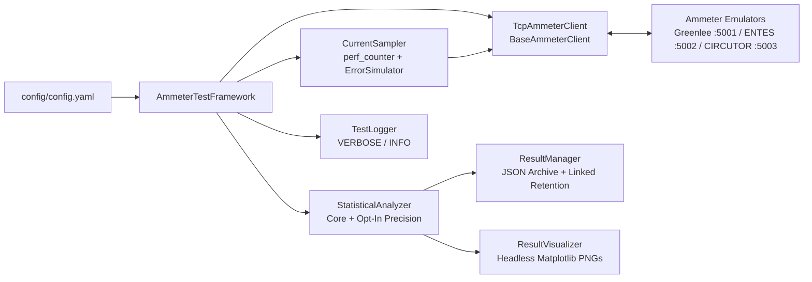
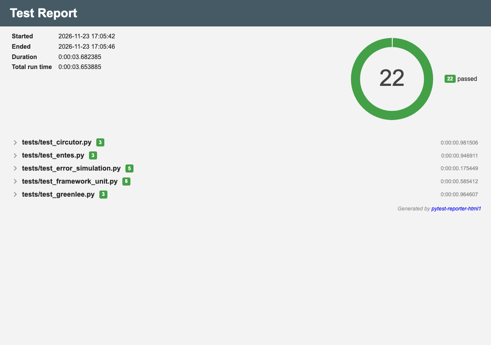
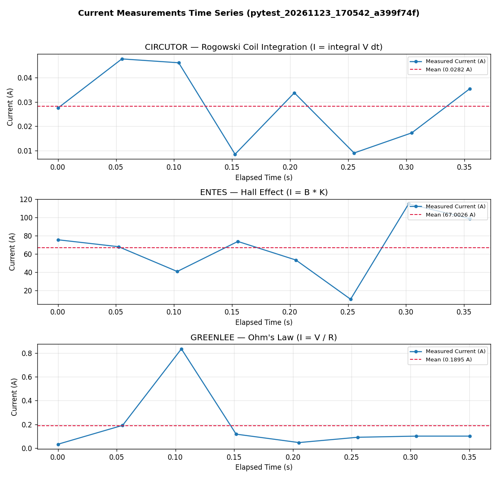
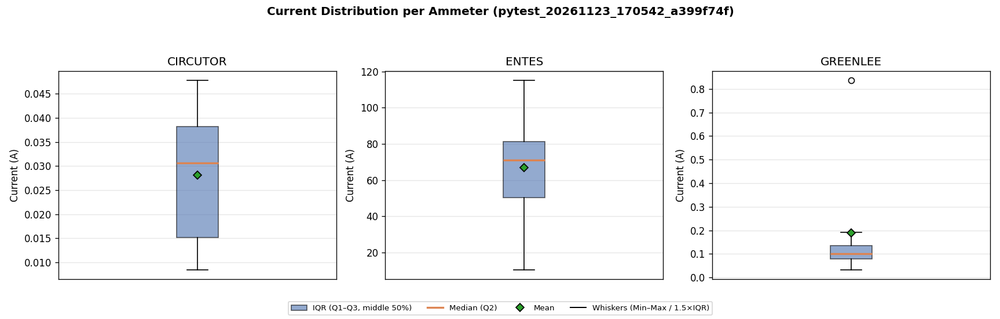
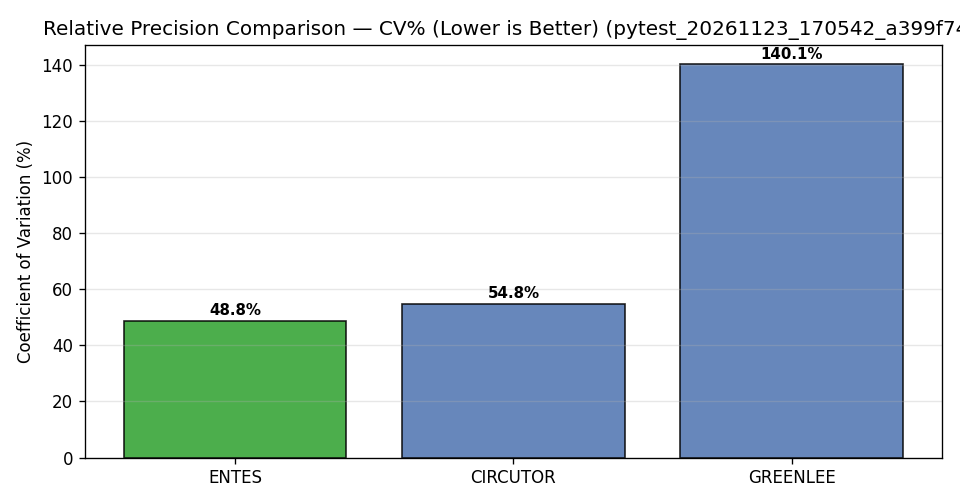

# Ammeter Testing Framework — Embedded Systems QA Automation

A modular, configuration-driven Python testing framework for evaluating embedded current measurement ammeter emulators (**Greenlee**, **ENTES**, and **CIRCUTOR**), built with strict SUT immutability, drift-compensated sampling, opt-in statistical precision analysis, self-contained HTML1 visual reports, and GitHub Actions CI.

Full system design specification: [docs/SDR.md](docs/SDR.md) | Sample JSON test result: [docs/sample_run.json](docs/sample_run.json).

---

## Architecture Overview



---

## Key Design Decisions

1. **Strict SUT Immutability**: Vendor emulator implementations (`Ammeters/Greenlee_Ammeter.py`, `Ammeters/Entes_Ammeter.py`, `Ammeters/Circutor_Ammeter.py`) were **never modified**. Only minimal, documented infrastructure fixes were applied to `base_ammeter.py`, `client.py`, and `main.py` (see [Bug-Fix Log](#starter-code-bug-fix-log)).
2. **KISS + Scalable OOP Client (`src/testing/ammeter_client.py`)**: All TCP emulators share the same wire contract (`command -> float`). `BaseAmmeterClient` (ABC) defines the contract, and a single config-driven `TcpAmmeterClient` serves all TCP ammeters — adding a 4th or 5th TCP ammeter requires **zero Python code changes**, only a YAML entry in `config/config.yaml`. Non-TCP protocols (Serial, Modbus) can subclass `BaseAmmeterClient` cleanly.
3. **2-of-3 Sampling Resolver (`src/utils/config.py`)**: Because `count = duration × frequency` is mathematically over-constrained, providing any 2 of (`measurements_count`, `total_duration_seconds`, `sampling_frequency_hz`) derives the 3rd automatically, and providing all 3 validates consistency (`ValueError` on conflict).
4. **Shared Analytics + Opt-In Precision Metrics (`src/analysis/analyzer.py`)**: Core metrics (`mean`, `median`, `std_dev`, `min`, `max`) run by default with zero per-ammeter duplication. Calibration/precision metrics (`CV`, `IQR`, `CI95`, `consistency_rating`) are **opt-in** via `include_precision_metrics=True` (or `--precision`) and power cross-ammeter reliability ranking.
5. **INFO vs. VERBOSE Configurable Logging (`src/utils/logger.py`)**:
   - Emulator `stdout` prints belong to the SUT and are never mixed into framework logs.
   - A custom **`VERBOSE` level (`15`, between `DEBUG=10` and `INFO=20`)** logs every individual sample reading (`elapsed`, `current_amps`) for QA auditing and math verification, while **`INFO`** logs only test lifecycle events and final statistics.
   - Controlled via `result_management.log_level` in `config/config.yaml` (`VERBOSE` in dev/QA; switchable to `INFO` in production/CI with zero code changes to prevent log bloat):
   ```text
   # log_level: VERBOSE (QA / Debugging — full per-sample audit trail)
   INFO     | Starting test for 'greenlee': count=8, duration=0.400s, freq=20.00Hz
   VERBOSE  | [greenlee] Sample 1/8 | elapsed=0.000s | current=0.057033 A
   VERBOSE  | [greenlee] Sample 2/8 | elapsed=0.055s | current=0.011694 A
   INFO     | Stats 'greenlee': mean=0.1012A, median=0.1105A, std=0.0641A, min=0.0117A, max=0.1935A, cv=63.32%, iqr=0.0905A, ci95=[0.0476, 0.1548]A, rating=low

   # log_level: INFO (Production / CI — compact summary only)
   INFO     | Starting test for 'greenlee': count=8, duration=0.400s, freq=20.00Hz
   INFO     | Stats 'greenlee': mean=0.1012A, median=0.1105A, std=0.0641A, min=0.0117A, max=0.1935A
   ```
6. **Per-Ammeter Sanity Fail-Fast Gate (`tests/conftest.py`)**:
   - `pytest_collection_modifyitems` guarantees `@pytest.mark.sanity` tests always execute **first** for each ammeter.
   - If an ammeter's sanity check fails (e.g., unreachable or out-of-range), `pytest_runtest_setup` **automatically skips** its dependent `sampling_and_core_stats` and `opt_in_precision_metrics` tests (`"Skipped: '<ammeter>' sanity test failed"`) — avoiding wasted execution and cascading false failures.
7. **Real-Data Visualizer & Self-Contained HTML1 Reports (`pytest-reporter-html1`)**:
   - Every `pytest` run creates a unique local-time report `results/reports/report_<run_id>.html` with real PNG plots embedded inline (no external Allure server required).
   - The combined visualizer test always runs after all ammeter tests, pulling live session data (or the latest archived run in `results/runs/`), and only falls back to clearly labeled **`[VIRTUAL / MOCK DATA]`** if no real run files exist.
8. **Configurable Artifact Retention & Standalone Cleanup Test (`pytest -m cleanup`)**:
   - `result_management.max_reports` in `config/config.yaml` (default `10`) controls how many latest reports to keep.
   - Running `pytest -m cleanup` executes `test_standalone_cleanup_old_reports_and_artifacts`, which prunes reports older than the latest `X` runs **together with all their linked PNG plots and JSON run files** across `results/reports/`, `results/plots/`, and `results/runs/`.

---

## Visual Reports & Screenshots

### 1. Self-Contained HTML1 Test Report (`results/reports/report_<run_id>.html`)
Every test run generates a single portable HTML1 report showing pass/fail status, markers, fixtures, captured logs, precision summaries, and embedded PNG charts:



### 2. Current Measurements Time Series (`time_series.png`)
Tracks measured current (A) over elapsed time (s) for each ammeter alongside its dashed mean reference line:



### 3. Current Distribution Boxplot (`distribution.png`)
Displays per-ammeter spread on independent scales with **IQR (Q1–Q3, middle 50%)**, **Median (Q2)**, **Mean (green diamond)**, **Whiskers (Min–Max / 1.5×IQR)**, and outliers:



### 4. Cross-Ammeter Precision Ranking (`summary_comparison.png`)
Compares scale-independent **Coefficient of Variation (`CV% = std_dev / mean`, lower is more consistent)** across ammeters:



### Cross-Ammeter Accuracy Findings
Because each emulator operates on a different physical scale (`0.001–0.1A` CIRCUTOR, `0.01–100A` Greenlee, `5–200A` ENTES), scale-independent **CV%** ranks relative precision fairly:
- **#1 CIRCUTOR** (Rogowski 10-sample integration): consistently achieves the lowest `CV` (~`40%–56%`) because summing 10 voltage samples averages out random variance.
- **#2 ENTES** (Hall Effect `B × K`): moderate-to-high dispersion (~`60%` CV).
- **#3 Greenlee** (Ohm's Law `V / R`): highest relative dispersion (~`80%+` CV) due to heavy right-skew spikes when `R → 0.1Ω`.

---

## Setup & Installed Dependencies

Python **3.9+** compatible (verified on Python 3.9.6 macOS and Python 3.11 Ubuntu CI).

```bash
python3 -m venv .venv
source .venv/bin/activate        # Windows: .venv\Scripts\activate
pip install -r requirements.txt
```

### Installed Libraries (`requirements.txt`)
| Package | Purpose |
| :--- | :--- |
| `pyyaml>=6.0` | YAML configuration loading (`config/config.yaml`) |
| `numpy>=1.21.0` | Core statistical calculations |
| `scipy>=1.7.0` | Exact t-distribution 95% confidence intervals (`CI95`) |
| `matplotlib>=3.4.0` | Headless (`Agg`) PNG visualization reports |
| `pytest>=7.0.0` | Modular test runner with marker-based selection |
| `pytest-reporter-html1>=0.9.0` | Single-file HTML1 test report with inline PNG plots |

---

## Usage

### 1. Verify Fixed Starter Script (`main.py`)
Starts all three emulators on ports `5001–5003` and reads one current value from each:
```bash
python main.py
```

### 2. Run Full Framework CLI (`run_suite.py`)
```bash
# Run all configured ammeters using config/config.yaml defaults (30 samples, 3.0s -> 10 Hz)
python run_suite.py

# Custom sampling override + opt-in precision metrics (CV, IQR, CI95)
python run_suite.py --count 15 --duration 1.0 --precision --log-level INFO

# Test specific ammeter(s) only
python run_suite.py --ammeters greenlee entes --count 10 --frequency 10

# List archived historical runs and compare two runs
python run_suite.py --list-runs
python run_suite.py --compare-runs <RUN_ID_A> <RUN_ID_B>
```

### 3. Run Modular `pytest` Suites, Visualizer & Standalone Cleanup
```bash
# Run full suite (23 tests: sanity -> functional/unit/negative -> visualizer -> cleanup)
pytest -v

# Pre-flight fail-fast sanity gate across all ammeters
pytest -m sanity -x -v

# Run a single ammeter suite (lazy fixtures start ONLY that emulator;
# if sanity fails, sampling & precision tests for that ammeter skip automatically)
pytest -m greenlee -v
pytest -m entes -v
pytest -m circutor -v

# Combine markers freely
pytest -m "sanity and greenlee" -v
pytest -m "greenlee or entes" -v
pytest -m unit -v
pytest -m negative -v

# Standalone artifact cleanup — keeps only the newest `max_reports` (config.yaml)
# HTML reports and deletes older reports together with their linked PNG plots & JSON runs
pytest -m cleanup -v
```

---

## Test Suite Coverage Matrix (What We Test & Why)

Every test in `tests/` maps directly to a core requirement, bonus challenge, or evaluation criterion from `Exam/ammeter-test-specification.md`. All 23 tests complete in ~`4s`.

### Per-Ammeter Sanity & Functional Suites (`test_greenlee.py`, `test_entes.py`, `test_circutor.py`)
Each ammeter has its own isolated suite and pytest marker (`greenlee`, `entes`, `circutor`) so teams can run one device, a subset, or all devices independently:

| Test (per ammeter) | Markers | What It Verifies & Why | Assignment Requirement |
| :--- | :--- | :--- | :--- |
| `test_<ammeter>_sanity` | `<ammeter>`, `sanity` | Pre-flight TCP reachability and valid physical range (`Greenlee: 0.01–100A`, `ENTES: 5–200A`, `CIRCUTOR: 0.001–0.1A`). Runs first; if it fails, dependent tests for that ammeter are automatically skipped. | Core #1 (Unified API) |
| `test_<ammeter>_sampling_and_core_stats` | `<ammeter>` | Collects 8 timed samples, validates exact sample count, zero errors, core metrics (`mean`, `median`, `std_dev`, `min`, `max`), confirms precision metrics are off by default, and embeds the real time-series PNG plot into the HTML1 report. | Core #2 (Sampling) & #3 (Result Analysis) |
| `test_<ammeter>_opt_in_precision_metrics` | `<ammeter>` | Enables `include_precision_metrics=True`, validates `CV`, `IQR`, `CI95`, and `consistency_rating`, and embeds real time-series + boxplot PNGs and precision summary into the HTML1 report. | Bonus #5 (Accuracy & Precision) |

### Framework Unit & Maintenance Tests (`tests/test_framework_unit.py` — markers: `unit`, `cleanup`)
Live emulator values are stochastic; offline deterministic unit tests guarantee exact math, config safety, archiving, visualization, and artifact retention:

| Test | What It Verifies & Why | Assignment Requirement |
| :--- | :--- | :--- |
| `test_sampling_resolver_all_two_of_three_pairs` | Any 2 of (`count`, `duration`, `frequency`) accurately derive the 3rd. | Core #2 (Sampling) |
| `test_sampling_resolver_rejects_conflicts_and_invalid_inputs` | Conflicting 3-of-3, under-specified (<2), or non-positive values raise `ValueError`. | Core #2 + Eval #3 (Error Handling) |
| `test_logger_verbose_vs_info_filtering` | `VERBOSE` (level 15) logs per-sample readings for QA auditing; `INFO` suppresses them for production clarity. | QA Engineering Enhancement |
| `test_statistical_analyzer_core_and_precision_metrics` | Deterministic math verification on `[10, 20, 30, 40, 50]` for exact core + opt-in precision metrics and empty-input error handling. | Core #3 + Bonus #5 |
| `test_cross_ammeter_accuracy_ranking` | Verifies scale-independent `CV` ranking identifies the more consistent ammeter (`steady` over `noisy`). | Bonus #5 (Reliability Ranking) |
| `test_result_manager_archive_retrieve_and_compare` | Verifies unique `run_id`, JSON persistence, reload by ID, historical listing, `compare_runs()` deltas, and `FileNotFoundError` on unknown IDs. | Core #4 (Result Management) |
| `test_visualizer_generates_png_plots` | Runs after all ammeter tests; generates combined `time_series`, `distribution` (with mean marker + legend), and `summary_comparison` PNGs from real session/archived data (falling back to clearly labeled `[VIRTUAL / MOCK DATA]` only if no real run exists) and embeds them in the HTML1 report. | Bonus #3 (Visualization) |
| `test_standalone_cleanup_old_reports_and_artifacts` | Standalone `@pytest.mark.cleanup` maintenance test: retains only the latest `max_reports` (configured in `config/config.yaml`) and removes older HTML reports along with their linked PNG plots and JSON runs. | QA Engineering Enhancement |

### Error Simulation & Negative Tests (`tests/test_error_simulation.py` — marker: `negative`)
Validates fault tolerance under simulated hardware anomalies and real TCP/protocol failures:

| Test | What It Verifies & Why | Assignment Requirement |
| :--- | :--- | :--- |
| `test_error_simulator_timeout_resilient_collection` | Simulated timeouts are captured cleanly in `errors` without crashing the sampling loop. | Bonus (Error Simulation) |
| `test_error_simulator_fail_fast_raises_immediately` | With `fail_fast=True`, simulated connection drops abort immediately as expected. | Bonus (Error Simulation) |
| `test_error_simulator_outlier_injection` | Simulated outlier multiplier injects controlled current spikes for anomaly testing. | Bonus (Error Simulation) |
| `test_connection_refused_on_closed_port` | Querying an unreachable TCP port raises a clear `ConnectionError`. | Eval #3 (Error Handling) |
| `test_invalid_command_against_live_greenlee_emulator` | Sending an invalid command to a live emulator (which closes with empty payload) raises `ValueError` cleanly. | Eval #3 (Error Handling) |
| `test_error_simulator_invalid_payload_and_validation` | Verifies `invalid_payload` injection mode and `ErrorSimulator` parameter validation (`failure_rate`, `error_mode`). | Bonus (Error Simulation) |

---

## Starter Code Bug-Fix Log

Per specification: *"if you get an error in the code, please fix it and explain the fix in the documentation."*

| File | Bug Found | Fix Applied |
| :--- | :--- | :--- |
| `main.py` | Client calls were commented out and used truncated commands (`MEASURE_GREENLEE`, `MEASURE_ENTES`, `MEASURE_CIRCUTOR`). | Uncommented calls with exact protocol commands and added graceful emulator shutdown (`stop()`). |
| `README.md` / `config/config.yaml` vs `Circutor_Ammeter.py` | Docs listed `MEASURE_CIRCUTOR -get_measurement`, while `CircutorAmmeter` requires `MEASURE_CIRCUTOR -get_measurement -current`. | Updated `config/config.yaml` and docs to match the untouched emulator command. |
| Ports (`5000–5002` vs `5001–5003`) | `README.md` listed `5000–5002`, which conflicts with macOS `ControlCenter` (AirPlay Receiver) on port `5000`. | Standardized default ports to `5001` (Greenlee), `5002` (ENTES), `5003` (CIRCUTOR) in `config/config.yaml` and `main.py`. |
| `Ammeters/base_ammeter.py` | Missing `SO_REUSEADDR` caused `Address already in use` on restart; blocking `accept()` prevented clean thread shutdown. | Added `SO_REUSEADDR`, non-blocking accept timeout (`0.2s`), and `stop()` method. |
| `Ammeters/client.py` | `request_current_from_ammeter()` only printed output and returned `None`, with no socket timeout or error handling. | Parsed and returned `float`, added `timeout`, and raised descriptive `TimeoutError`/`ConnectionError`/`ValueError`. |
| `src/utils/logger.py` | Built `log_file` path without attaching handlers, formatter, or log level. | Attached `FileHandler` + `StreamHandler`, formatter, duplicate-handler guard, and `VERBOSE=15` level. |
| `src/testing/test_framework.py` | Missing `Dict` import (`NameError`) and empty `run_test()` (`pass`). | Implemented full `AmmeterTestFramework`. |

---

## CI/CD (GitHub Actions)

Workflow: [.github/workflows/ci.yml](.github/workflows/ci.yml)
1. Runs `pytest -m sanity -x -v` as a fail-fast pre-flight gate.
2. Runs full `pytest -v` (or a selected marker via manual `workflow_dispatch`).
3. Executes `python run_suite.py --count 15 --duration 1.0 --precision --log-level INFO`.
4. Uploads `results/reports/`, `results/runs/`, and `results/plots/` as downloadable workflow artifacts (`results/` itself stays excluded from Git via `.gitignore`).
