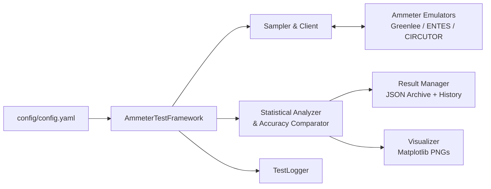

# System Design Requirements (SDR) — Ammeter Testing Framework

## 1. Objective & Scope
Build a clean, modular, cross-platform Python testing framework for embedded current measurement emulators (**Greenlee**, **ENTES**, **CIRCUTOR**).  
Design principle: **KISS (Keep It Simple)** — fulfill every core and bonus requirement cleanly without unnecessary frameworks or over-engineering.

### Deliverables
1. Complete Python implementation in `src/` with minimal, documented fixes to starter infrastructure.
2. Configuration-driven execution via `config/config.yaml`.
3. Automated `pytest` test suite + GitHub Actions CI workflow (`.github/workflows/ci.yml`).
4. Sample test results (JSON + visual reports) in `results/`.
5. Updated `README.md` with setup, installed dependencies, usage, bug-fix log, and design decisions.

---

## 2. Starter Code Audit — Bugs & Planned Fixes

Per specification constraint: *"Use existing ammeter emulation infrastructure — if you get an error in the code, please fix it and explain the fix in the documentation."*  
We keep emulator measurement logic (`Greenlee_Ammeter.py`, `Entes_Ammeter.py`, `Circutor_Ammeter.py`) untouched and apply only minimal infrastructure fixes:

| # | File | Issue Found | Planned Fix | Rationale |
| :- | :--- | :--- | :--- | :--- |
| 1 | `main.py` | Client calls are commented out and send truncated commands (`MEASURE_GREENLEE`, `MEASURE_ENTES`, `MEASURE_CIRCUTOR`). | Uncomment and send exact emulator commands (`-get_measurement`, `-get_data`, `-get_measurement -current`). | Makes `main.py` work out of the box per *Before You Start*. |
| 2 | `README.md` vs `main.py` & `config/config.yaml` | Port mismatch: `README.md` lists `5000–5002`, `main.py` uses `5001–5003`. On macOS, `ControlCenter` (AirPlay Receiver) occupies port `5000`. | Standardize default ports to `5001` (Greenlee), `5002` (ENTES), `5003` (CIRCUTOR) in `config/config.yaml` and `main.py`, while keeping ports configurable. | Ensures cross-platform reliability (macOS, Linux, Windows, CI). |
| 3 | `README.md` & `config/config.yaml` vs `Circutor_Ammeter.py` | Docs list `MEASURE_CIRCUTOR -get_measurement`, but `CircutorAmmeter.get_current_command` requires `MEASURE_CIRCUTOR -get_measurement -current`. | Update `config/config.yaml` and `README.md` to match `CircutorAmmeter`. | Preserves emulator code untouched while fixing protocol mismatch. |
| 4 | `Ammeters/base_ammeter.py` | Missing `SO_REUSEADDR`; blocking `accept()` prevents clean shutdown; invalid commands silently drop connection. | Add `SO_REUSEADDR` and optional graceful stop event (`stop()`). | Prevents `Address already in use` errors between test runs and enables clean teardown in `pytest`. |
| 5 | `Ammeters/client.py` | `request_current_from_ammeter()` prints output and returns `None`; no socket timeout or error handling. | Return parsed `float` (raise clear exception on timeout/empty/invalid response) and add `timeout` parameter. | Makes client usable programmatically while keeping `main.py` compatible. |
| 6 | `src/testing/test_framework.py` | Missing `Dict` import (`NameError`); `run_test()` is empty (`pass`). | Implement full `AmmeterTestFramework`. | Core framework entry point. |
| 7 | `src/utils/logger.py` | Builds `log_file` path but attaches no handlers, formatter, or log level. | Configure `FileHandler` + `StreamHandler`, formatter, and duplicate-handler guard. | Enables structured file and console logging. |

---

## 3. Functional Requirements

### 3.1 Scalable OOP Ammeter Client (`src/testing/`) & Unified API
- **Strict Immutability**: `Ammeters/Greenlee_Ammeter.py`, `Ammeters/Entes_Ammeter.py`, and `Ammeters/Circutor_Ammeter.py` are treated as read-only vendor deliverables and are **never modified**.
- **KISS + Scalable OOP (Zero Boilerplate)**:
  - Because all current emulators return a single `float` (Amperes) over TCP, we avoid redundant per-ammeter boilerplate classes.
  - `BaseAmmeterClient` (ABC) defines the minimal contract (`read_current() -> float`, `name`, `method`).
  - `TcpAmmeterClient(BaseAmmeterClient)` handles any TCP ammeter purely from `config/config.yaml` (`port`, `command`, `host`, `timeout`, `method`) — adding a 4th/5th TCP ammeter requires **zero code changes**, only a YAML entry.
  - Future non-TCP or custom-protocol ammeters can subclass `BaseAmmeterClient` without touching the sampler, framework, or analyzer.
- **Unified API**: `AmmeterTestFramework` orchestrates sampling, analysis, storage, and visualization with consistent structured output (`TestResult` / `dict`).
- **Out of Scope (Future Nice-to-Have)**: Lightweight HTML debug UI is intentionally excluded from core deliverables to preserve KISS.

### 3.2 Measurement Sampling & Parameter Resolution
- Supports `measurements_count`, `total_duration_seconds`, and `sampling_frequency_hz`.
- **2-of-3 Derivation & Validation**:
  - `count` + `duration` → `frequency = count / duration`
  - `duration` + `frequency` → `count = round(duration * frequency)`
  - `count` + `frequency` → `duration = count / frequency`
  - All 3 provided → validate consistency (`|count - duration * frequency| <= 1`); raise `ValueError` on conflict.
- Uses `time.perf_counter()` drift-compensated scheduling for accurate inter-sample intervals.
- **Default `config/config.yaml` values**: `measurements_count: 30`, `total_duration_seconds: 3.0`, `sampling_frequency_hz: null` (derived `10.0 Hz`).

### 3.3 Statistical Analysis (`src/analysis/`)
- Per-run core metrics: `mean`, `median`, `std_dev`, `min`, `max`, plus sample count and actual elapsed duration.
- **Bonus — Opt-In Precision & Accuracy Assessment**:
  - Extended calibration/precision metrics (`CV`, `IQR`, `CI95`) are **opt-in** via `include_precision_metrics=True` (default `False` to keep regular runs lightweight).
  - Cross-ammeter comparison table ranking measurement precision/reliability (noting each emulator's physical model: Ohm's Law `V/R`, Hall Effect `B*K`, Rogowski integration `∑V·dt`).

### 3.4 Result Management (`src/storage/`)
- Unique `run_id` per test run (timestamp + short UUID).
- Persists JSON artifacts with metadata, raw samples, timing, and statistical metrics under `results/runs/`.
- Retrieval API: load by `run_id`, list historical runs, and compare two or more runs.

### 3.5 Visualization (`src/visualization/`) — Bonus
- Configurable via `config/config.yaml` (`analysis.visualization.enabled`).
- Generates clean PNG plots under `results/plots/` using `matplotlib` (headless `Agg` backend for CI compatibility):
  1. Time-series plot of current measurements per ammeter.
  2. Distribution / boxplot comparison across ammeters.
  3. Statistical summary bar chart (mean ± std / CV comparison).

### 3.6 Error Simulation & Handling — Bonus
- Graceful handling of connection refused, socket timeouts, invalid commands, empty responses, and malformed payloads.
- Configurable error-simulation hook (timeout, invalid command, dropped sample, injected outlier) for negative QA testing without modifying emulator logic.

### 3.7 Structured Logging & Configurable Verbosity (QA Engineering Enhancement)
- **SUT vs. Framework Separation**: Emulator `stdout` prints belong to the System Under Test and are never mixed into test framework logs.
- **Custom `VERBOSE` Log Level (`15`, between `DEBUG=10` and `INFO=20`)**:
  - Individual per-sample current readings (`[ammeter] Sample i/N | elapsed=...s | current=... A`) are logged at `VERBOSE` level.
  - Test lifecycle events (start, completion, totals) are logged at `INFO` level; sample failures at `WARNING`.
  - Controlled via `result_management.log_level` in `config/config.yaml` (defaults to `VERBOSE` during development/QA for full calculation auditability; switchable to `INFO` in production/CI to prevent log bloat with zero code changes).

---

## 4. Architecture & Project Layout



```text
NESS_Automation_Home_Task/
├── Ammeters/                  # Starter emulators (minimal infra fixes only)
├── config/
│   └── config.yaml            # Full config (sampling, ammeters, analysis, storage)
├── docs/
│   └── SDR.md                 # This document
├── src/
│   ├── testing/
│   │   ├── ammeter_client.py  # BaseAmmeterClient (ABC) + config-driven TcpAmmeterClient
│   │   ├── sampler.py         # Drift-compensated sampling + 2-of-3 resolver + error sim
│   │   └── test_framework.py  # Unified AmmeterTestFramework API
│   ├── analysis/
│   │   └── analyzer.py        # Stats (mean/median/std/min/max) + CV/IQR/accuracy ranking
│   ├── storage/
│   │   └── result_manager.py  # Run ID, JSON persistence, history retrieval & diff
│   ├── visualization/
│   │   └── visualizer.py      # Headless matplotlib plots
│   └── utils/
│       ├── config.py          # YAML loader + schema validation
│       ├── logger.py          # File + console logger
│       └── Utils.py           # Existing utility
├── tests/                     # pytest unit & integration tests
├── results/                   # Sample runs, logs, and plots
├── .github/workflows/ci.yml   # GitHub Actions pytest pipeline
├── main.py                    # Fixed starter verification script
├── run_suite.py               # Clean CLI runner for full framework & reports
├── requirements.txt           # Pinned minimal dependencies
└── README.md                  # Setup, usage, bug-fix log, design decisions
```

---

## 5. Implementation Gates (Step-by-Step Verification Plan)

Each gate must pass verification and scope review before advancing to the next gate.

| Gate | Scope | Verification Criteria |
| :--- | :--- | :--- |
| **Gate 1: Baseline & Emulators** | Create `.venv`, install deps, apply minimal fixes to `main.py`, `base_ammeter.py`, `client.py`, `logger.py`, and populate `config/config.yaml`. | `python main.py` starts all 3 emulators in threads and returns valid `float` currents from Greenlee, ENTES, and CIRCUTOR with zero errors. |
| **Gate 2: Unified API & Sampler** | Implement `src/utils/config.py` (validation + 2-of-3 sampling), `src/testing/sampler.py`, and `src/testing/test_framework.py`. | Unit & live-emulator tests confirm exact sample counts, accurate timing, and structured result output for all 3 ammeters. |
| **Gate 3: Analysis & Accuracy** | Implement `src/analysis/analyzer.py` (core stats + consistency + cross-ammeter accuracy ranking). | Verified against known deterministic datasets and live emulator runs. |
| **Gate 4: Storage & Visualization** | Implement `src/storage/result_manager.py` and `src/visualization/visualizer.py` + `run_suite.py` CLI. | Generates unique Run IDs, reloads/compares historical runs, and outputs PNG plots in `results/plots/`. |
| **Gate 5: Error Simulation & pytest Suite** | Implement error simulation tests + full `tests/` suite (`pytest`) covering unit, integration, and negative scenarios. | `pytest -v` passes 100% locally with clean teardown. |
| **Gate 6: CI, Sample Results & Docs** | Add `.github/workflows/ci.yml`, generate sample results, finalize `README.md` (with bug-fix log & design decisions), verify git cleanliness. | Clean repo ready for Public GitHub push; CI workflow validated. |
