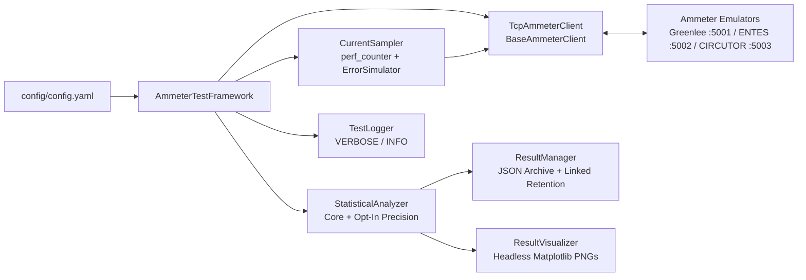

# System Design Requirements (SDR) — Ammeter Testing Framework

## 1. Objective & Scope
Build a clean, modular, cross-platform Python testing framework for evaluating embedded current measurement emulators (**Greenlee**, **ENTES**, **CIRCUTOR**).  
Design principle: **KISS (Keep It Simple)** — fulfill every core and bonus requirement cleanly without unnecessary frameworks or over-engineering.

### Deliverables
1. Complete Python implementation in `src/` with minimal, documented fixes to starter infrastructure.
2. Configuration-driven execution via `config/config.yaml`.
3. Modular `pytest` test suite (27 tests) with marker-based selection, fail-fast sanity gating, and self-contained HTML1 reports.
4. GitHub Actions CI workflow (`.github/workflows/ci.yml`) uploading `results/reports/`, `results/runs/`, and `results/plots/` as artifacts (`results/` excluded from Git via `.gitignore`).
5. Updated `README.md` with architecture, design decisions, sample JSON run (`docs/sample_run.json`), visual report previews (`docs/images/`), setup, usage, test coverage matrix, and bug-fix log.

---

## 2. Starter Code Audit — Bugs & Applied Fixes

Per specification constraint: *"Use existing ammeter emulation infrastructure — if you get an error in the code, please fix it and explain the fix in the documentation."*  
Emulator measurement logic (`Greenlee_Ammeter.py`, `Entes_Ammeter.py`, `Circutor_Ammeter.py`) remains untouched; only minimal infrastructure fixes were applied:

| # | File | Issue Found | Applied Fix | Rationale |
| :- | :--- | :--- | :--- | :--- |
| 1 | `main.py` | Client calls were commented out and sent truncated commands (`MEASURE_GREENLEE`, `MEASURE_ENTES`, `MEASURE_CIRCUTOR`). | Uncommented calls with exact emulator commands (`-get_measurement`, `-get_data`, `-get_measurement -current`) and added graceful `stop()` shutdown. | Makes `main.py` work out of the box per *Before You Start*. |
| 2 | `README.md` vs `main.py` & `config/config.yaml` | Port mismatch: `README.md` listed `5000–5002`, `main.py` used `5001–5003`. On macOS, `ControlCenter` (AirPlay Receiver) occupies port `5000`. | Standardized default ports to `5001` (Greenlee), `5002` (ENTES), `5003` (CIRCUTOR) in `config/config.yaml` and `main.py`, while keeping ports configurable. | Ensures cross-platform reliability (macOS, Linux, Windows, CI). |
| 3 | `README.md` & `config/config.yaml` vs `Circutor_Ammeter.py` | Docs listed `MEASURE_CIRCUTOR -get_measurement`, but `CircutorAmmeter.get_current_command` requires `MEASURE_CIRCUTOR -get_measurement -current`. | Updated `config/config.yaml` and `README.md` to match `CircutorAmmeter`. | Preserves emulator code untouched while fixing protocol mismatch. |
| 4 | `Ammeters/base_ammeter.py` | Missing `SO_REUSEADDR`; blocking `accept()` prevented clean shutdown. | Added `SO_REUSEADDR`, non-blocking accept timeout (`0.2s`), and graceful `stop()` event. *(Invalid commands still close without a reply per vendor behavior; `client.py` reports this as `ValueError: Empty response`.)* | Prevents `Address already in use` errors between test runs and enables clean teardown in `pytest`. |
| 5 | `Ammeters/client.py` | `request_current_from_ammeter()` printed output and returned `None`; no socket timeout or error handling. | Returned parsed `float`, added `timeout`, and raised descriptive `TimeoutError`/`ConnectionError`/`ValueError`. | Makes client usable programmatically while keeping `main.py` compatible. |
| 6 | `src/testing/test_framework.py` | Missing `Dict` import (`NameError`); `run_test()` was empty (`pass`). | Implemented full `AmmeterTestFramework`. | Core framework entry point. |
| 7 | `src/utils/logger.py` | Built `log_file` path without attaching handlers, formatter, or log level. | Configured `FileHandler` + `StreamHandler`, formatter, duplicate-handler guard, and `VERBOSE=15` level. | Enables structured file and console logging. |

---

## 3. Functional Requirements & Implemented Design

### 3.1 Scalable OOP Ammeter Client (`src/testing/`) & Unified API
- **Strict Immutability**: `Ammeters/Greenlee_Ammeter.py`, `Ammeters/Entes_Ammeter.py`, and `Ammeters/Circutor_Ammeter.py` are treated as read-only vendor deliverables and are **never modified**.
- **KISS + Scalable OOP (Zero Boilerplate)**:
  - `BaseAmmeterClient` (ABC) defines the minimal contract (`read_current() -> float`, `name`, `method`).
  - `TcpAmmeterClient(BaseAmmeterClient)` handles any TCP ammeter purely from `config/config.yaml` (`port`, `command`, `host`, `timeout`, `method`) — adding a 4th/5th TCP ammeter requires **zero Python code changes**, only a YAML entry.
  - Future non-TCP or custom-protocol ammeters can subclass `BaseAmmeterClient` without touching the sampler, framework, or analyzer.
- **Unified API**: `AmmeterTestFramework` orchestrates sampling, analysis, storage, and visualization with consistent structured output.

### 3.2 Measurement Sampling & Parameter Resolution (`src/testing/sampler.py`, `src/utils/config.py`)
- Supports `measurements_count`, `total_duration_seconds`, and `sampling_frequency_hz`.
- **2-of-3 Derivation & Validation**:
  - `count` + `duration` → `frequency = count / duration`
  - `duration` + `frequency` → `count = round(duration * frequency)`
  - `count` + `frequency` → `duration = count / frequency`
  - All 3 provided → validate consistency (`|count - duration * frequency| <= 1`); raise `ValueError` on conflict.
- Uses `time.perf_counter()` drift-compensated scheduling for accurate inter-sample intervals.
- **Default `config/config.yaml` values**: `measurements_count: 30`, `total_duration_seconds: 3.0`, `sampling_frequency_hz: null` (derived `10.0 Hz`).

### 3.3 Statistical Analysis (`src/analysis/analyzer.py`)
- Per-run core metrics: `mean`, `median`, `std_dev`, `min`, `max`, plus sample count and actual elapsed duration.
- **Bonus — Opt-In Precision & Reliability Assessment**:
  - Extended calibration/precision metrics (`CV`, `IQR`, `CI95`, `consistency_rating`) are **opt-in** via `include_precision_metrics=True` (default `False` to keep regular runs lightweight). `CI95` uses an embedded two-sided 95% Student-t table to avoid a SciPy dependency.
  - Cross-ammeter comparison ranks by reading reliability (`success_rate` descending) first, then scale-independent `CV% = std_dev / mean` ascending (noting each emulator's physical model: Ohm's Law `V/R`, Hall Effect `B*K`, Rogowski integration `∑V·dt`).

### 3.4 Result Management & Linked Artifact Retention (`src/storage/result_manager.py`)
- Unique local-time `run_id` per test run (`YYYYMMDD_HHMMSS_<uuid8>`, or `pytest_...` for pytest sessions).
- Persists JSON artifacts with metadata, raw timestamped samples, timing, and statistical metrics under `results/runs/`.
- Retrieval API: load by `run_id`, list historical runs, and compare two runs (`compare_runs()`).
- **Configurable Artifact Retention**: `result_management.max_reports` (default `10`) controls retention across `results/reports/`, `results/plots/`, and `results/runs/`, pruning older HTML reports together with their linked PNG plots and JSON run files.

### 3.5 Visualization & Self-Contained HTML1 Reports (`src/visualization/visualizer.py`, `tests/conftest.py`)
- Configurable via `config/config.yaml` (`analysis.visualization.enabled`).
- Generates clean PNG plots under `results/plots/` using `matplotlib` (headless `Agg` backend for CI compatibility):
  1. `time_series.png` — Current measurements over elapsed time per ammeter with dashed mean reference line.
  2. `distribution.png` — Per-ammeter boxplot on independent scales showing IQR (Q1–Q3), Median (Q2), Mean (green diamond marker + explanatory legend), whiskers (Min–Max / 1.5×IQR), and outliers.
  3. `summary_comparison.png` — Cross-ammeter relative precision bar chart (`CV%`).
- **Self-Contained HTML1 Reports (`pytest-reporter-html1`)**:
  - Every `pytest` run writes a unique `results/reports/report_<run_id>.html` with inline embedded PNG plots (no external server required).
  - Combined visualizer runs after all ammeter tests using live session data (or the latest archived run in `results/runs/`), falling back to clearly labeled `[VIRTUAL / MOCK DATA]` only if no real run files exist.

### 3.6 Error Simulation & Handling (`src/testing/sampler.py`)
- Graceful handling of connection refused, socket timeouts, invalid commands, empty responses, and malformed payloads.
- Configurable error-simulation hook (timeout, connection drop, fail-fast mode, injected outlier multiplier) for negative QA testing without modifying emulator logic.

### 3.7 Structured Logging & Configurable Verbosity (`src/utils/logger.py`)
- **SUT vs. Framework Separation**: Emulator `stdout` prints belong to the System Under Test and are never mixed into test framework logs.
- **Custom `VERBOSE` Log Level (`15`, between `DEBUG=10` and `INFO=20`)**:
  - Individual per-sample current readings (`[ammeter] Sample i/N | elapsed=...s | current=... A`) are logged at `VERBOSE` level.
  - Test lifecycle events (start, completion, stats) are logged at `INFO` level; sample failures at `WARNING`.
  - Controlled via `result_management.log_level` in `config/config.yaml` (`VERBOSE` in dev/QA; `INFO` in production/CI).

---

## 4. Architecture & Project Layout



```text
NESS_Automation_Home_Task/
├── Ammeters/                  # Starter emulators (minimal infra fixes only)
├── config/
│   └── config.yaml            # Sampling, ammeters, analysis, visualization, result_management
├── docs/
│   ├── SDR.md                 # This document
│   └── images/                # Static preview screenshots for README.md
├── src/
│   ├── testing/
│   │   ├── ammeter_client.py  # BaseAmmeterClient (ABC) + config-driven TcpAmmeterClient
│   │   ├── sampler.py         # Drift-compensated sampling + ErrorSimulator
│   │   └── test_framework.py  # Unified AmmeterTestFramework API
│   ├── analysis/
│   │   └── analyzer.py        # Core stats + opt-in CV/IQR/CI95 + reliability/precision ranking
│   ├── storage/
│   │   └── result_manager.py  # Run ID, JSON persistence, history diff, linked cleanup
│   ├── visualization/
│   │   └── visualizer.py      # Headless matplotlib plots (time_series, distribution, summary)
│   └── utils/
│       ├── config.py          # YAML loader + 2-of-3 sampling validation
│       ├── logger.py          # File + console logger with VERBOSE=15
│       └── Utils.py           # Existing utility
├── tests/
│   ├── conftest.py            # Lazy emulator fixtures, EMULATOR_VALID sanity flags, execution ordering, HTML1 hooks
│   ├── test_greenlee.py       # Greenlee sanity + sampling + precision tests
│   ├── test_entes.py          # ENTES sanity + sampling + precision tests
│   ├── test_circutor.py       # CIRCUTOR sanity + sampling + precision tests
│   ├── test_framework_unit.py # Offline unit tests + combined visualizer + standalone cleanup
│   └── test_error_simulation.py # Error simulator + live negative TCP/protocol tests
├── results/                   # Git-ignored runtime artifacts (reports/, runs/, plots/, logs/)
├── .github/workflows/ci.yml   # GitHub Actions pytest + CLI artifact pipeline
├── pytest.ini                 # Markers, HTML1 template, testpaths
├── main.py                    # Fixed starter verification script
├── run_suite.py               # Clean CLI runner for full framework & reports
├── requirements.txt           # Minimal dependencies (minimum versions)
└── README.md                  # Setup, usage, test matrix, bug-fix log, design decisions
```

---

## 5. Test Suite Design & Coverage (27 Tests)

### Execution Ordering & Fail-Fast Sanity Gate (`tests/conftest.py`, `pytest.ini`)
1. **Priority Ordering (`pytest_collection_modifyitems`)**:
   - Priority `0`: `@pytest.mark.sanity` (all ammeter pre-flight checks run first)
   - Priority `1`: Functional ammeter tests (`greenlee`, `entes`, `circutor`), `unit`, and `negative` tests
   - Priority `2`: Combined `test_visualizer_generates_png_plots`
   - Priority `3`: `@pytest.mark.cleanup` (`test_standalone_cleanup_old_reports_and_artifacts`)
2. **Global Per-Emulator Sanity Flags (`EMULATOR_VALID`, `pytest_runtest_setup`, `pytest_runtest_makereport`)**:
   - `EMULATOR_VALID = {"greenlee": False, "entes": False, "circutor": False}` resets to `False` at session start (`pytest_configure`).
   - Passing `@pytest.mark.sanity` flips `EMULATOR_VALID[ammeter] = True`.
   - Before any dependent ammeter test runs, `pytest_runtest_setup` verifies `EMULATOR_VALID[ammeter]` and fails immediately with `Emulator [<ammeter>] not valid` if `False` (unrelated suites like `unit`, `negative`, and valid ammeters continue normally inside one unified run ID and one HTML1 report).
3. **Markers (`pytest.ini`)**: `sanity`, `greenlee`, `entes`, `circutor`, `unit`, `negative`, `cleanup`.

### Test Coverage Matrix

| Suite / File | Test Name | Markers | Verification Scope |
| :--- | :--- | :--- | :--- |
| `test_greenlee.py` | `test_greenlee_sanity` | `greenlee`, `sanity` | TCP reachability and valid range (`0.01–100A`). |
| `test_greenlee.py` | `test_greenlee_sampling_and_core_stats` | `greenlee` | 8 timed samples, core stats (`mean`, `median`, `std_dev`, `min`, `max`), precision off by default, inline PNG plot. |
| `test_greenlee.py` | `test_greenlee_opt_in_precision_metrics` | `greenlee` | `include_precision_metrics=True` (`CV`, `IQR`, `CI95`, `consistency_rating`), inline time-series + boxplot PNGs. |
| `test_entes.py` | `test_entes_sanity` | `entes`, `sanity` | TCP reachability and valid range (`5–200A`). |
| `test_entes.py` | `test_entes_sampling_and_core_stats` | `entes` | 8 timed samples, core stats, precision off by default, inline PNG plot. |
| `test_entes.py` | `test_entes_opt_in_precision_metrics` | `entes` | Opt-in precision metrics + inline time-series + boxplot PNGs. |
| `test_circutor.py` | `test_circutor_sanity` | `circutor`, `sanity` | TCP reachability and valid range (`0.001–0.1A`). |
| `test_circutor.py` | `test_circutor_sampling_and_core_stats` | `circutor` | 8 timed samples, core stats, precision off by default, inline PNG plot. |
| `test_circutor.py` | `test_circutor_opt_in_precision_metrics` | `circutor` | Opt-in precision metrics + inline time-series + boxplot PNGs. |
| `test_framework_unit.py` | `test_sampling_resolver_all_two_of_three_pairs` | `unit` | 2-of-3 derivation across all `(count, duration, frequency)` pairs. |
| `test_framework_unit.py` | `test_sampling_resolver_rejects_conflicts_and_invalid_inputs` | `unit` | Rejects conflicting 3-of-3, under-specified (<2), non-positive values, and single-flag overrides (`ValueError`). |
| `test_framework_unit.py` | `test_logger_reinstantiation_writes_to_new_file` | `unit` | Re-instantiating `TestLogger` replaces stale handlers and writes to the new file. |
| `test_framework_unit.py` | `test_logger_verbose_vs_info_filtering` | `unit` | `VERBOSE` (15) logs per-sample readings; `INFO` (20) suppresses them. |
| `test_framework_unit.py` | `test_statistical_analyzer_core_and_precision_metrics` | `unit` | Exact deterministic math on `[10, 20, 30, 40, 50]` (including Student-t `CI95`) and empty-input error handling. |
| `test_framework_unit.py` | `test_reliability_ranking_penalizes_errors` | `unit` | Verifies higher `success_rate` outranks lower `CV` when readings fail. |
| `test_framework_unit.py` | `test_cross_ammeter_accuracy_ranking` | `unit` | Scale-independent `CV` ranking identifies more consistent ammeter. |
| `test_framework_unit.py` | `test_result_manager_archive_retrieve_and_compare` | `unit` | Unique `run_id`, JSON persistence, reload, listing, `compare_runs()`, `FileNotFoundError`. |
| `test_framework_unit.py` | `test_visualizer_generates_png_plots` | `unit` | Combined `time_series`, `distribution`, `summary_comparison` PNGs from real session/archived data (mock fallback only if none exist) + HTML1 embed. |
| `test_framework_unit.py` | `test_standalone_cleanup_old_reports_and_artifacts` | `cleanup` | Retains latest `max_reports` HTML reports and deletes older reports with linked PNG plots and JSON runs. |
| `test_error_simulation.py` | `test_error_simulator_timeout_resilient_collection` | `negative` | Simulated timeouts captured in `errors` without crashing sampling loop. |
| `test_error_simulation.py` | `test_error_simulator_fail_fast_raises_immediately` | `negative` | `fail_fast=True` aborts immediately on simulated connection drop. |
| `test_error_simulation.py` | `test_error_simulator_outlier_injection` | `negative` | Controlled outlier multiplier injection for anomaly testing. |
| `test_error_simulation.py` | `test_connection_refused_on_closed_port` | `negative` | Closed TCP port raises `ConnectionError`. |
| `test_error_simulation.py` | `test_invalid_command_against_live_greenlee_emulator` | `negative` | Invalid command to live emulator raises `ValueError` cleanly. |
| `test_error_simulation.py` | `test_error_simulator_invalid_payload_and_validation` | `negative` | Verifies `invalid_payload` mode and `ErrorSimulator` parameter validation. |
| `test_error_simulation.py` | `test_real_socket_timeout_raises_timeout_error` | `negative` | Real `client.py` `recv()` timeout against silent local TCP server (`TimeoutError`). |
| `test_error_simulation.py` | `test_real_socket_non_numeric_payload_raises_value_error` | `negative` | Real `client.py` float parser against malformed TCP response (`ValueError`). |

---

## 6. Implementation Gates (Completed)

| Gate | Scope | Status |
| :--- | :--- | :--- |
| **Gate 1: Baseline & Emulators** | `.venv`, minimal starter fixes (`main.py`, `base_ammeter.py`, `client.py`, `logger.py`), `config/config.yaml`, live verification. | **Done** |
| **Gate 2: Unified API & Sampler** | `src/utils/config.py` (validation + 2-of-3 sampling), `src/testing/ammeter_client.py`, `src/testing/sampler.py`, `src/testing/test_framework.py`. | **Done** |
| **Gate 3: Analysis & Precision** | `src/analysis/analyzer.py` (core stats + opt-in precision metrics + reliability/precision ranking). | **Done** |
| **Gate 4: Storage & Visualization** | `src/storage/result_manager.py`, `src/visualization/visualizer.py`, `run_suite.py` CLI. | **Done** |
| **Gate 5: Error Simulation & pytest Suite** | `tests/` (27 tests), `tests/conftest.py` (HTML1 reports, fail-fast sanity gate, ordering, retention cleanup). | **Done** |
| **Gate 6: CI, Docs & Git Hygiene** | `.github/workflows/ci.yml`, `.gitignore` (`results/`), `docs/images/`, `README.md`, `docs/SDR.md`. | **Done** |
